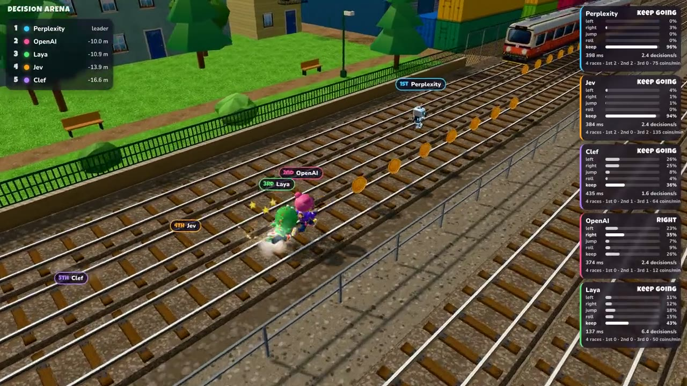
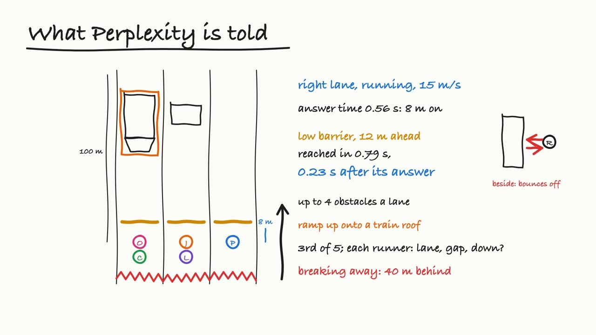
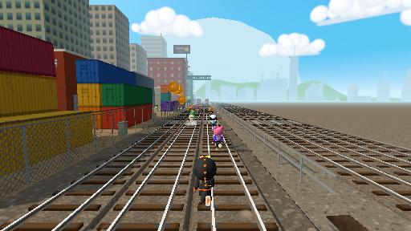
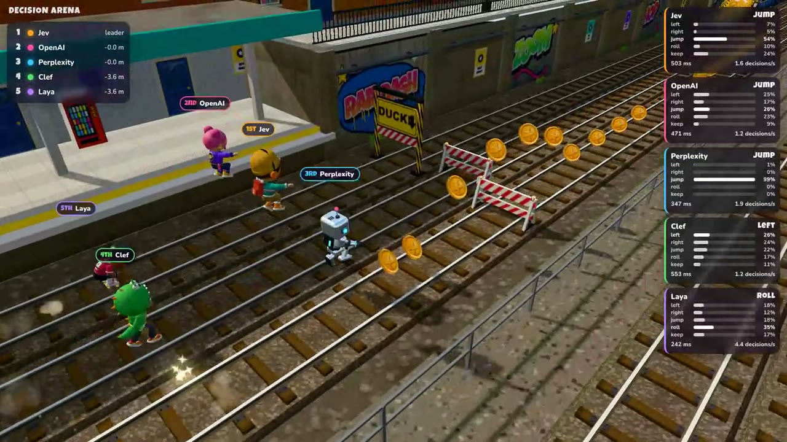

# Decision Arena

Fast decision models race each other in a real-time 3D runner game. Up to six
runners share three train-track lanes full of barriers, ramps and trains, while
the ground breaks away behind them. Each runner is driven by a different
decision model, and the last one standing wins.

There are no turns. A model answers with one move, the move is made the moment
the answer arrives, and the model is asked again straight away. A fast model
decides several times while a slow one decides once, and the world keeps moving
while a model thinks. You see both how well and how fast each model decides.

[](https://youtu.be/zo50Fkto2JQ)

*[Watch a race](https://youtu.be/zo50Fkto2JQ) (28 s, with sound): Jev, OpenAI, Perplexity, Laya and Clef in
the fifth of five races. The decision panel on the right shows each model's record from the
first four.*

[](https://youtu.be/dgG4_fvZqdM)

*[Watch how it works](https://youtu.be/dgG4_fvZqdM) (4 min, captions in the video, [transcript](docs/explainer.srt)):
what a decision model gets and answers, a real question word for word, and why the race is
fair.*

[Decision Arena playlist on YouTube](https://www.youtube.com/playlist?list=PLbt997ez0__g)

## Run it

You need [uv](https://docs.astral.sh/uv/). No key is needed to start: Laya, a
decision model, runs on your own computer.

```bash
uv tool install 'laya[serve]'   # Laya's engine, once; its model (about 850 MB) downloads on first start
uv run decision-arena           # Laya races a built-in bot
```

To race more models, copy `.env.example` to `.env` and fill in the keys you have:
every model with a key joins the race. With no key and no Laya, four built-in bots
race, so you can still see the game.

The page opens in your browser. Press Space to start a race, D to show or hide
the decision panel, and C to switch camera.

By default every model with a key races, with the image twins (see below), up to nine
runners, except d1-3B. Choose players with
`--players`, for example `uv run decision-arena --players jev,openai,laya`.
`--runners` sets the number of runners (two to nine); `bot` fills a seat with a
built-in runner that isn't a model. `--port` and `--no-browser` do what they
say.

| Player | Model | Key in `.env` |
|---|---|---|
| `jev` | Jev 1.13 at TypeSafe | `TYPESAFE_API_KEY` |
| `openai` | GPT-6 Luna, OpenAI Decisions API | `OPENAI_API_KEY` |
| `perplexity` | Perplexity Decider 1.1 | `PERPLEXITY_API_KEY` |
| `laya` | Laya, on your computer | none: install it with `uv tool install 'laya[serve]'` |
| `d1` | Liquid d1-3B, on your computer, only when named | none: needs llama.cpp build 11483 or newer (see below) |
| `clef` | Cloudflare Clef-flash on Workers AI | `CLOUDFLARE_ACCOUNT_ID`, `CLOUDFLARE_AUTH_TOKEN` |
| `aplomb` | Aplomb 1 at EmpirioLabs | `EMPIRIO_LABS_API_KEY` |
| `openai-image`, `perplexity-image`, `clef-image`, `aplomb-image` | the same model as its image twin | its model's key |
| `microsoft` | Microsoft Decision-1, through Vercel's AI Gateway | `AI_GATEWAY_API_KEY` |
| `liquid` | Liquid D1, through Vercel's AI Gateway | `AI_GATEWAY_API_KEY` |

d1-3B races only when you name it (`--players jev,laya,d1`). It needs more memory
than a 16 GB Mac can spare beside the game: there, the race dropped from about 50
frames a second to about 6. It suits a machine with more memory.

For d1-3B, install a [llama.cpp release](https://github.com/ggml-org/llama.cpp/releases)
from build b11483 on, so that `llama-server` is on your `PATH`; `brew install llama.cpp`
works too once Homebrew's version reaches that build. The command checks the build and
says if it's too old.

The two local models download on their first start: about 850 MB for Laya and
2.9 GB for d1-3B. After that they start in seconds. d1-3B's weights come from
[Liquid's page](https://huggingface.co/LiquidAI/d1-3B-GGUF) under Liquid's LFM
Open License, separate from this project's MIT licence. That license doesn't
cover commercial use by a company with $10 million or more in annual revenue.

Before the race, every model is asked one question. If any of them fails to
answer, the command stops and tells you which model failed and which key to
check, so you can replace it:

```text
Not starting. OpenAI did not answer (HTTP 401: Incorrect API key provided: [key]. You can find your API key at https://platform.openai.com/account/api-keys.). Check OPENAI_API_KEY in .env, or choose other players.
```

Keys stay in the local server. They are never sent to the page, logged or shown
on screen.

## Fair races

- **Same track.** Every runner in a race runs the same track from a shared
  start. Each race gets a new track.
- **Every start slot.** The grid has up to three rows of three slots. The
  slots rotate one place every race, so over as many races as there are runners
  (five races for five models), each model starts once from every slot. Nine
  runners move one row back and one lane across each race, and every third race
  one more lane, so over nine races each starts once from every slot. The
  rotation carries on across page reloads and server restarts.
- **Same question.** Every model is asked by the same code, with the same
  fields and the same wording. Only the runner's own position and its own
  model's answer time differ.
- **Same moves.** Every model chooses from the same five moves, which the game
  applies the same way for every runner.
- **No waiting.** The game never waits for a model. Speed is part of the
  contest, which is why each model is told how long its own answers take.

## What each model is asked

Each time, a model gets one question: a description of what its runner sees,
instructions, and five described moves. Here is a real question from a
five-model race, sent to Perplexity as it ran in the right lane at the start:

**State**

> A race on three train-track lanes, left, middle and right, all running
> forward. You are in the right lane, running, at 15 m/s. Your answers take
> about 0.56 s, so your move is made about 8 m further on. Your last move was
> keep. Your lane (right): a low barrier (jump over it) 12 m ahead, reached in
> 0.79 s (0.23 s after your answer). Left lane: a low barrier (jump over it) 12
> m ahead, reached in 0.79 s (0.23 s after your answer); then a ramp 59 m ahead,
> reached in 4.06 s (3.50 s after your answer), up onto a standing train's roof,
> 26 m long. Middle lane: a low barrier (jump over it) 12 m ahead, reached in
> 0.79 s (0.23 s after your answer); then a standing train, 12 m long, 70 m
> ahead, reached in 4.79 s (4.23 s after your answer). You are 3rd of 5. Jev is
> level with you in the middle lane. OpenAI is level with you in the left lane.
> Laya is 4 m behind you in the middle lane. Clef is 4 m behind you in the left
> lane. The ground is breaking away 40 m behind you.

**Instructions** (the same in every question)

> Choose this runner's next move. Crashing into a barrier or the front of a
> train knocks it down and costs ground; the ground breaking away behind it ends
> its race. Your move is made when your answer arrives, so allow for your answer
> time. A lane change takes 0.13 s. A jump lasts 0.61 s and clears a low barrier
> you reach 0.10 to 0.55 s after jumping, or a buffer stop you reach 0.14 to
> 0.50 s after: jump too early and you land before it. A roll gets you under a
> high barrier you reach within 0.64 s of rolling: roll too early and you stand
> up before it. Changing lanes into the side of a train or barrier bounces you
> back and costs speed. Trains are too high to jump onto, except with spring
> shoes; a ramp runs straight up onto its train's roof. On a roof, ground
> obstacles pass below you; where the roof ends you drop to the ground, unless
> the next roof starts within 3 m. Running into another runner's back trips you,
> changing lanes into one bounces you back, and jumping takes you over one.

Perplexity answered `jump`, 99% sure, in 0.66 s, a little slower than its usual
0.56 s. So it reached the barrier 0.13 s after jumping, inside the 0.10 to 0.55 s
window.

**Moves**

| Move | Description |
|---|---|
| `left` | move one lane to the left |
| `right` | move one lane to the right (you are already in the right lane: nothing happens) |
| `jump` | jump: clears low barriers and buffer stops |
| `roll` | roll: slides under high barriers |
| `keep` | keep going as you are |

### Image twins

OpenAI, Perplexity, Clef and Aplomb accept images, so each also races as its
image twin, in the same race as the model itself. A twin gets the same question,
with one extra sentence, "A picture of your view, from just behind and above
you, looking ahead, is attached.", and the picture: a 512 x 288 render of its
runner's own view, taken when the question is sent. Nothing else differs, so
the race shows whether seeing helps each model. Jev and Laya don't take images
and race on text alone. An image twin wears its model's character in a second
outfit.



### What goes into the state

In this order:

- **Your runner:** its lane; what it is doing (running, changing lanes from
  which lane to which, in the air and when it lands, rolling and when it stands
  up, on a train roof, wearing spring shoes, protected after a crash); its
  speed; and its last move.
- **Your answer time:** the mean of its model's last five answer times, and how
  far the runner travels in that time. It's left out of the first question of
  a race, because there is no answer time yet.
- **The lanes:** your own lane first, then the other two, each over the next
  100 m, up to four obstacles a lane, nearest first. For each obstacle you get
  its distance, when you reach it at your current speed (a train coming at you
  closes at both speeds), and how long after your answer arrives that is. A
  ramp is told together with the train whose roof it leads onto. A train
  beside you says how far it goes on, and, in the next lane, that moving into
  that lane now bounces you off it. On a roof, barriers are marked as on the
  ground below.
- **The other runners:** place, and every other runner still racing, nearest
  first, with its lane, its gap, and whether it is down after a crash.
- **The collapse:** how far behind the ground is breaking away, and whether it
  is gaining.

The text gives facts and the game's rules. It never says which move to make.
The jump and roll windows come from the game itself: they were measured by
stepping its physics (`gameplay/physics.js`) at 14, 20 and 28 m/s.

### The request

Jev, Perplexity, Clef, Aplomb, Laya and d1-3B take the System One request shape:

```json
{
  "model": "jev-1.13.0",
  "state": "A race on three train-track lanes, ...",
  "questions": {
    "move": {
      "type": "choice",
      "instructions": "Choose this runner's next move. ...",
      "criteria": {
        "left": "move one lane to the left",
        "right": "move one lane to the right (you are already in the right lane: nothing happens)",
        "jump": "jump: clears low barriers and buffer stops",
        "roll": "roll: slides under high barriers",
        "keep": "keep going as you are"
      }
    }
  }
}
```

OpenAI, Microsoft and Liquid take the OpenAI Decisions shape. It carries the
same text, with the moves as a list:

```json
{
  "model": "gpt-6-luna",
  "input": "A race on three train-track lanes, ...",
  "questions": [
    {
      "type": "choice",
      "name": "move",
      "instructions": "Choose this runner's next move. ...",
      "choices": [
        { "value": "left", "description": "move one lane to the left" },
        { "value": "jump", "description": "jump: clears low barriers and buffer stops" }
      ]
    }
  ]
}
```

(The example lists two of the five choices; every request sends all five.)

An image twin's request adds the picture as a base64 JPEG, in the form each API
reads, each checked with a test picture:

| API | Where the picture goes |
|---|---|
| OpenAI | `input` becomes a user message: `{"type": "input_text", ...}` and `{"type": "input_image", "image_url": "data:image/jpeg;base64,..."}` |
| Perplexity | `state` becomes `[text, {"type": "image_url", "image_url": {"url": "data:..."}}]` |
| Clef | an `images` list next to `state`: `["data:image/jpeg;base64,..."]` |
| Aplomb | `state` becomes `[text, {"type": "image", "data": "<base64>", "mime": "image/jpeg"}]` |



Each model answers with its choice and a probability for each move. The
decision panel shows both, with the model's latency and decisions per second,
and its record over the races since the page loaded: how often it finished
first, second and third, and coins a minute on the track. The cards are ordered
by that record. Coins count per minute because a race stops when one runner is
left; models aren't told where coins are, and coins change nothing in the race.
An answer that isn't one of the five moves, or whose probabilities don't add
up, is shown as an error, and the runner asks again half a second later.

### Check it yourself

- `src/decision_arena/web/src/race/models.js`, `see()`: what the page reports
  a runner sees.
- `src/decision_arena/models.py`, `question()`: how that becomes the text
  above.
- `src/decision_arena/apis.py`: the requests sent to each API.
- `uv run pytest`: runs the tests, with recorded answers and no keys.

## Add your own model

A model is a class with a `name` and an async `decide` method that turns a
`Question` into an `Answer`:

```python
from decision_arena.models import Answer, Question


class AlwaysJump:
    name = "Jumper"

    async def decide(self, question: Question) -> Answer:
        # question.state is the text above, question.options the five described moves
        return Answer("jump", {"left": 0, "right": 0, "jump": 1, "roll": 0, "keep": 0})
```

Add it to `PLAYERS` in `src/decision_arena/server.py`, under the name you want
to type:

```python
PLAYERS = {
    ...,
    "jumper": AlwaysJump,
}
```

Then race it: `uv run decision-arena --players jumper,jev`.

If your model already serves the System One or OpenAI Decisions shape over
HTTP, you don't need a class: add a function to `apis.py` like the ones there.

```python
def mine() -> DecisionAPI:
    return _api("Mine", "https://example.com/v1/decisions", "my-model", "MY_API_KEY", "openai")
```

## More

[docs/decisions.md](docs/decisions.md) records how the game and the race are
designed, and why. The game is built on the Rail Dash runner engine, in the
browser with three.js. MIT licensed.
