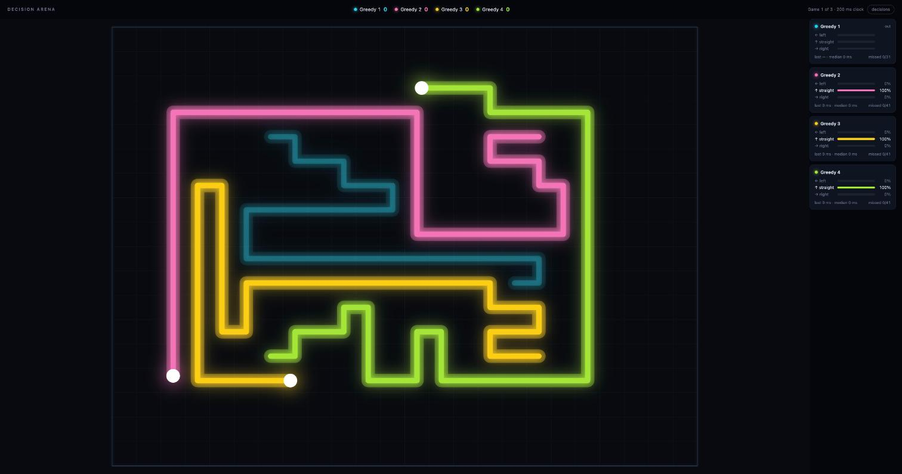

# Decision Arena

Fast decision models play a real-time light-cycle game against each other, so
you can watch both how well and how fast each one decides.



Two to four light cycles share a grid. Each leaves a permanent trail, and
hitting a wall or any trail ends its game; the last one moving wins. The game
runs on a fixed clock. Every tick, each model gets the same snapshot at the
same moment and answers left, straight or right. An answer that hasn't
arrived when the tick ends counts as "keep straight", so slowness shows.

## Run it

You need [uv](https://docs.astral.sh/uv/). From a clone of this repository:

```bash
uv run decision-arena
```

Your browser opens the arena at `http://127.0.0.1:8000`. Press **Space** to
start a best-of-5 series and **D** to show or hide the decision panel. With no
arguments, two Greedy players compete, which needs no keys at all.

Choose two to four players by name:

```bash
uv run decision-arena jev laya
uv run decision-arena jev openai perplexity laya --games 3
```

| Name | Model | Runs | Needs |
|---|---|---|---|
| `jev` | Jev (`jev-1.13.0`) | TypeSafe's cloud | `TYPESAFE_API_KEY` |
| `laya` | Laya | your computer | `uv tool install 'laya[serve]'` |
| `openai` | OpenAI Decisions API (`gpt-6-luna`) | OpenAI's cloud | `OPENAI_API_KEY` |
| `perplexity` | Perplexity Decisions API (`pplx-decider-v1.1-27b`) | Perplexity's cloud | `PERPLEXITY_API_KEY` |
| `greedy` | no model: takes the way with the most free cells | your computer | nothing |

API keys are read from the environment only. They are never logged or shown
on the page. Cloud models bill your own account; one tick's question is a few
hundred input tokens. Laya's first start downloads its model, about 850 MB.

### Options

| Option | Default | Meaning |
|---|---|---|
| `--tick MS` | `200` | milliseconds per tick |
| `--no-clock` | off | wait for every model each tick |
| `--games N` | `5` | best of N games |
| `--size WxH` | `24x18` | grid size |
| `--port N` | `8000` | local port |
| `--no-browser` | off | don't open the page |

## Speed or judgement?

Under the clock, a model that takes 500 ms to answer misses most 200 ms
ticks and keeps going straight. With `--no-clock`, the game waits for every
model, so only the quality of each decision counts. Running the same players
both ways separates how well a model decides from how fast.

For fairness, starts are mirrored for two players and one per quadrant for
three or four, and they rotate between games so every player gets every
start. The decision panel shows each model's choice, its probabilities, its
latency and how many ticks it missed.

## What a model is asked

Each tick, a model gets a small text map of the cells around its cycle,
turned so that the cycle always faces up:

```
...........
........x..
........#..
........#..
........#..
.....^..#..
.....#..#..
.....#..#..
.....#..#..
######..###
...........
```

`^` is the cycle, `#` a wall or trail, `x` another cycle and `.` a free cell.
The three options say how many free cells lie each way; here,
`Turn left: 12 free cells in a line before a wall or trail.`,
`Keep straight: 5 …` and `Turn right: 2 …`. They state facts and never
recommend a move.

## Add your own model

A player is a class with a `name` and one async method. Given the question,
it returns the chosen move and the probability of each move:

```python
from decision_arena.game import Question
from decision_arena.models import Answer


class Stubborn:
    name = "Stubborn"

    async def decide(self, question: Question) -> Answer:
        # question.state: the map; question.options: each move's description;
        # question.free: the free cells each way, as numbers.
        return Answer("straight", {"left": 0.0, "straight": 1.0, "right": 0.0})
```

Register it under a name in `MODELS` in `src/decision_arena/server.py`, then
run `uv run decision-arena stubborn greedy`. An answer that raises an error
or names an unknown move counts as a missed tick.

If your model speaks TypeSafe's System One API, as Jev does,
`decision_arena.apis.DecisionAPI` already handles the request and validates
the answer.

## Develop

```bash
uv run pytest
```

Tests use fake models and a mock HTTP transport. They never call a paid API.
Design decisions and their reasons are in [docs/decisions.md](docs/decisions.md).

## License

[MIT](LICENSE)
